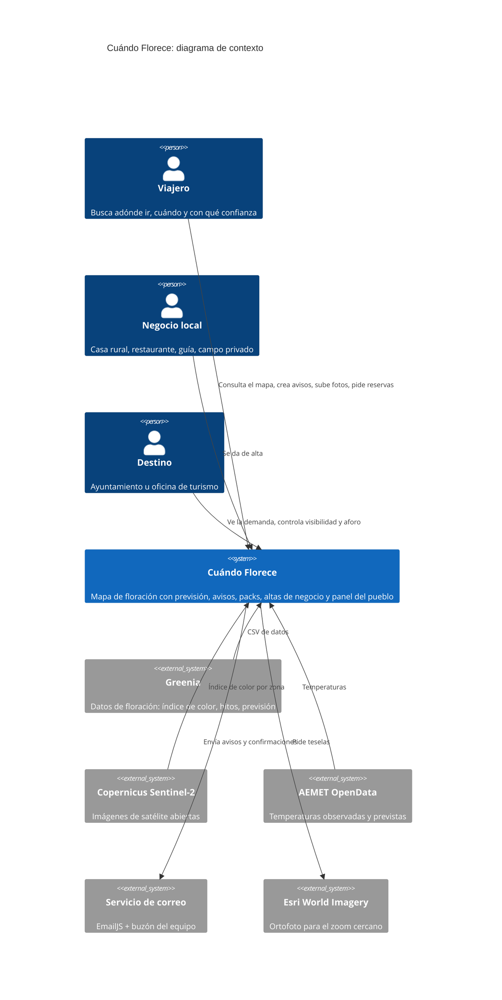
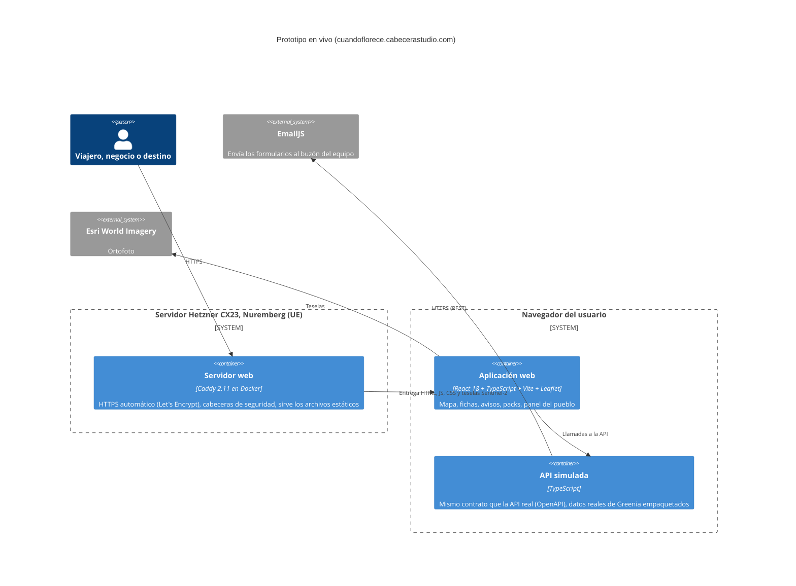
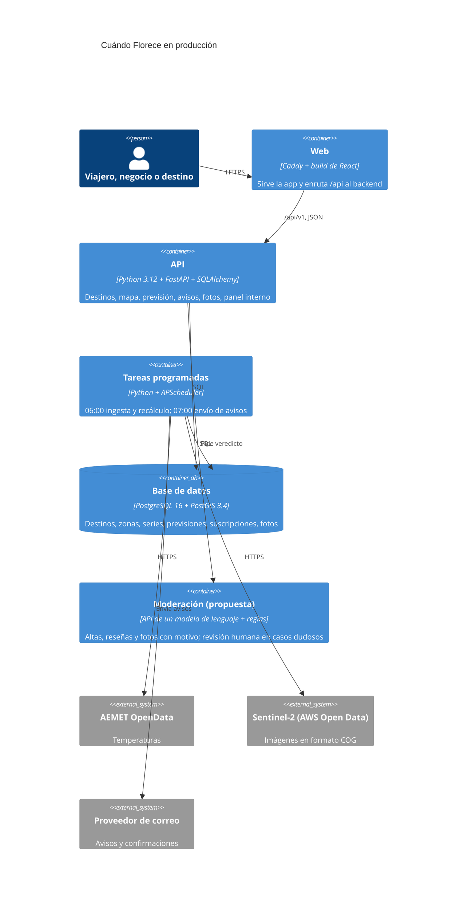

# Cuándo Florece · Entrega final (jueves 22, 16:30)

Esto es lo que falta para entregar, qué pide el jurado en cada documento y toda la información que necesitáis para escribirlos. El estado anterior de este README (la lista del 21 de octubre) está en [docs/estado-21-oct.md](docs/estado-21-oct.md).

**Web en vivo:** https://cuandoflorece.cabecerastudio.com
**Código que se entrega:** rama `luka` de este repo. Es la app de Marco (React + TypeScript, backend FastAPI con 25 tests) con nuestro diseño, los 7 destinos, los packs de Pablo y lo de rodri (formularios por correo, reserva sin pago, filtros, privacidad).

**Entrega:** por Canvas y por el Forms que nos dan a la entrada. **El jurado lee los archivos antes del pitch.**

---

## 1. Los 6 entregables

| # | Entregable | Estado |
|---|---|---|
| 1 | Presentación (PPT o PDF), la misma del pitch | Sin empezar |
| 2 | Business Model Canvas (PDF) | **Hecho:** [entregables/business-model-canvas.pdf](entregables/business-model-canvas.pdf) |
| 3 | Memoria breve de viabilidad | **Hecho:** [entregables/memoria-viabilidad.pdf](entregables/memoria-viabilidad.pdf) |
| 4 | Arquitectura y diagramas C4 | **Hecho:** [entregables/arquitectura-c4.pdf](entregables/arquitectura-c4.pdf) (diagramas sueltos en `entregables/diagramas/`) |
| 5 | Prototipo y código | Hecho (web en vivo). Falta el zip del código |
| 6 | README breve (1 página) | Sin empezar. Guion en la sección 6 |
| | Pitch en directo (4 min + 2 min de preguntas) | Sin ensayar |

## 2. Cómo puntúa el jurado

| Peso | Criterio | Dónde se gana |
|---|---|---|
| 25 % | Business Model Canvas y viabilidad | Canvas + memoria: los 9 bloques coherentes, costes, recursos, **barreras y cómo superarlas**, cómo se sostiene |
| 25 % | Solución técnica y arquitectura C4 | Diagramas de contexto y contenedores, tecnologías justificadas, flujo de datos, límites, seguridad y RGPD |
| 20 % | Comprensión del reto y del usuario | Presentación + memoria: problema, usuarios, **datos y fuentes** en vez de suposiciones |
| 15 % | Prototipo | La web: lo esencial funcionando, usable, coherente con la arquitectura, limitaciones contadas con honestidad |
| 10 % | Pitch | Claridad, tiempo, demo, defensa en las preguntas |
| 5 % | Impacto social y ética | **Indicadores**, accesibilidad, privacidad, sostenibilidad |

El 70 % se juega en los documentos. Comprensión del reto (20 %) y ética (5 %) no tienen documento propio: tienen que salir en la presentación **y** en la memoria (comparativas de otros países y la tabla de impacto de la sección 4.6).

## 3. Lo que es real y lo que es simulado

Esto tiene que decirse igual en la presentación, la memoria, el C4 y el README. El jurado premia contar las limitaciones.

**Real en la web:**
- Los datos de Greenia: Tejera Negra (índice de color por satélite en 7 zonas, temperaturas, hitos, previsión) y la lavanda de Brihuega (temporada, avance, previsión 2027).
- Los otros 4 destinos (Jerte, Alpujarra, Tejeda, Teide) y Montejo con fechas de fuentes públicas citadas en cada ficha.
- Imágenes de satélite Sentinel-2 propias para el mapa.
- **Los 5 formularios envían correo de verdad** (aviso, foto ciudadana, alta de negocio, contacto para licencia, solicitud de reserva). Llegan al correo del equipo y la persona recibe una confirmación.
- Los packs con alojamientos y restaurantes reales y precios «desde» consultados en octubre de 2026.

**Simulado en la demo (y marcado como «simulado» en la web):**
- La demanda del panel del pueblo («1.240 personas esperan la lavanda») y los indicadores de impacto.
- La moderación con IA de las altas y reseñas: son casos preparados, no una llamada real a un modelo.
- La API: en la web en vivo funciona dentro del navegador con los mismos datos y el mismo contrato que el backend real. El backend existe y tiene tests, pero no está desplegado.
- La «fecha de hoy» de la demo está fijada al 20 de octubre de 2026, la fecha de los datos.

---

## 4. Memoria breve de viabilidad (3 a 5 páginas)

**Qué pide el jurado:** propuesta de valor, costes, recursos, implantación, sostenibilidad y posibles barreras.

**Estructura recomendada:**
1. El problema y el usuario (media página)
2. Propuesta de valor (media página)
3. Modelo de ingresos y precios (1 página)
4. Costes, recursos y año 1 (media página)
5. Implantación por fases (media página)
6. Barreras y cómo las superamos (media página)
7. Impacto, ética e indicadores (media página)

Escribidla en español, con frases cortas, y marcad las cifras que son estimación. Abajo está todo el material.

### 4.1 El problema

- **Viajero:** no sabe cuándo ir. Llega con la flor pasada o al valle colapsado. Hoy solo hay calendarios fijos y blogs.
- **Destino:** su oficina de turismo actualiza a mano el estado de la flor. **El Valle del Jerte publica a diario el estado de los cerezos a mano** en un blog y una app. No tiene datos de demanda y sufre aglomeraciones: los alojamientos del Jerte llegan al 120 % en temporada y **Tejera Negra solo tiene 130 plazas de aparcamiento con reserva previa**.
- **Negocio local:** no aparece en el momento en que el viajero decide ir.
- **La España vaciada:** pueblos que pierden población y servicios porque nadie los conoce.
- **El público no es un nicho:** es el viajero normal de escapada de fin de semana. Vermont recibe unos 2,5 millones de visitantes en otoño que gastan unos 500 millones de dólares.

### 4.2 Qué hacen en otros países (quién paga)

**En ningún país paga el viajero por saber cuándo florece.** Pagan los destinos y los negocios, porque la temporada les deja mucho dinero.

| País | Qué hay | Quién paga |
|---|---|---|
| Japón (cerezos) | La agencia meteorológica dejó de dar la previsión en 2010; la hacen empresas privadas. Weathernews tiene más de 2 millones de fotos de usuarios desde 2004 | Empresas (B2B) y suscripciones generales del tiempo. Las agencias de viaje (JTB) ganan con el viaje. Walker+ licencia sus datos a Google Maps |
| EE. UU. (otoño) | **La oficina de turismo de New Hampshire paga su propio mapa de follaje** desde 2015 (prevé 3,7 millones de visitantes y 1.800 millones de dólares). SmokyMountains.com usa un mapa gratis para vender sus cabañas | Organismos públicos de turismo y negocios de alojamiento |
| Países Bajos (tulipanes) | Keukenhof: unos 25 millones de euros con 1,4 millones de visitantes; los productores donan 7 millones de bulbos como escaparate | La visita (entradas y concesiones) |
| Francia (lavanda) | Rutas y calendario sin estado en directo; se pregunta a las oficinas de turismo | Las visitas guiadas y los tours |
| España | El Jerte lo hace a mano. Brihuega: pasear por los campos es gratis; se pagan conciertos y visitas guiadas | Nadie automatiza esto: es nuestro hueco |

Comisiones de referencia: Civitatis paga a sus afiliados del 8 al 10 %; GetYourGuide cobra del 20 al 30 % a sus proveedores.

### 4.3 Propuesta de valor

> **Llevamos visitantes a la España rural en su mejor momento, y el pueblo decide cuántos.**
> Un motor de previsión de floración que los destinos contratan y los viajeros usan gratis.

- **Viajero (B2C, gratis):** adónde ir, cuándo y con qué confianza. Una ventana de fechas con su margen, no una fecha falsa. Avisos y packs con alojamiento y mesa reales.
- **Negocio local (B2B):** aparecer justo cuando el viajero decide ir, con sello de negocio verificado.
- **Destino (B2G):** previsión automática que sustituye la actualización manual; panel con la demanda agregada (cuántos esperan la flor y de dónde vienen); **control de visibilidad y aforo**: el pueblo baja su exposición o marca «aforo completo» y el mapa manda a la gente a días entre semana y a pueblos cercanos.

### 4.4 Ingresos

| Línea | Precio | Por qué funciona |
|---|---|---|
| **Licencia de destino (principal)** | Unos 6.000 € al año (de 4.000 a 12.000 € según tamaño) | Pocos clientes y precio alto: no necesita tráfico masivo. Por debajo de 15.000 € es un **contrato menor** (Ley 9/2017, art. 118), sin concurso público. Es un gasto que el destino ya tiene: hoy paga a alguien por hacerlo a mano |
| **Ficha de negocio verificado** | Unos 99 € por temporada | Alta autoservicio que propone el propio destino; moderada automáticamente |
| **Comisión por pack o reserva** | 8 al 10 %, la paga el alojamiento o la actividad | Para el viajero es gratis. Siempre marcada como comercial. No somos agencia de viajes: pasamos la solicitud al alojamiento, que es quien vende |
| **Arranque** | Fondos de los Planes de Sostenibilidad Turística en Destinos (PSTD) | Financiación pública para el piloto (convocatorias por confirmar) |

**Lo que hemos descartado y por qué** (pregunta segura del jurado):
- **Publicidad:** web de temporada con tráfico solo unas semanas al año. Ingresos muy bajos.
- **Avisos de pago para el viajero:** ningún país lo hace y cierra la puerta a quien nos trae el tráfico.
- **Vender datos personales:** ilegal sin consentimiento (RGPD y LOPDGDD). **Solo damos cifras agregadas** («3.200 avisos para el Jerte, 60 % desde Madrid»), sin identificar a nadie, y van incluidas en la licencia.
- **Vender packs nosotros:** un viaje con transporte y alojamiento es un «viaje combinado» y exige licencia de agencia de viajes. Por eso cobramos comisión en lugar de vender.

### 4.5 Costes, recursos y año 1 (todo estimación)

| Año 1 | |
|---|---|
| 5 destinos piloto × 6.000 € | 30.000 € |
| 150 fichas de negocio × 99 € | 14.850 € |
| Comisiones (unas 400 reservas × unos 8 €) | unos 3.000 € |
| **Ingresos** | **unos 48.000 €** |
| Personal: 2 personas a tiempo completo | unos 62.000 € |
| Ventas, ferias y asesoría legal | unos 5.000 € |
| Infraestructura: servidor, correo, mapas, API de IA para moderar | 2.000 a 3.000 € |
| Datos (Sentinel-2, AEMET, Greenia) | 0 € |
| **Costes** | **unos 70.000 €** |

- **Punto de equilibrio: unos 8 destinos** (cada destino aporta unos 6.000 € de licencia más unas 30 fichas, unos 9.000 €).
- **Escalar casi no cuesta:** añadir un destino es configuración (coordenadas, especie, umbrales, fuentes), no código.
- **Recursos clave:** plataforma y modelo de previsión, datos y colaboración con Greenia, histórico de temporadas, fotos ciudadanas, equipo de 6 personas, presupuesto inicial máximo de 2.000 €.
- Ojo: el canvas dice «equipo de 6» (somos nosotros en el hackathon) y «presupuesto inicial de 2.000 €» (lo que cuesta el piloto: servidor, dominio, correo). Los 70.000 € son el año 1 con 2 personas a sueldo. Explicadlo así para que no parezca una contradicción.

### 4.6 Implantación por fases

1. **Piloto (primera temporada):** 3 destinos gratis a cambio de un caso de éxito: Brihuega (lavanda, julio), Valle del Jerte (cerezo, marzo y abril) y Tejera Negra (hayedo, octubre y noviembre). Así cubrimos primavera, verano y otoño.
2. **Primeras licencias:** venta directa a oficinas de turismo y a mancomunidades o diputaciones que agrupan varios pueblos. Feria FITUR.
3. **Crecer por especie:** almendro (Alpujarra, Cieza, Mallorca), azahar (Sevilla, Valencia), hayedos (Irati, Montejo).
4. **Visión (solo una diapositiva):** «bono de floración flexible»: compras estancia y experiencia y la fecha se confirma sola cuando la previsión entra en ventana.

### 4.7 Barreras y cómo las superamos

| Barrera | Cómo la superamos |
|---|---|
| La venta pública es lenta y paga tarde | Contratos menores (menos de 15.000 €, sin concurso); piloto gratis; vender a mancomunidades que agrupan varios pueblos |
| La previsión falla en un año raro | Siempre damos un margen con su confianza; el satélite y las fotos confirman el estado real; publicamos nuestro acierto |
| Nubes sobre el satélite | La zona se marca «sin dato» y se usa la temperatura y el histórico |
| Pocas temporadas de histórico | Modelo v0 que mejora cada temporada; página «cómo calculamos esto» transparente |
| Negocios y reseñas falsos | Moderación con IA que explica el motivo, comprobación de ubicación y fecha de la foto (3 km, 72 h) y revisión humana en casos dudosos |
| Masificar los pueblos | El pueblo controla su visibilidad y aforo; el mapa reparte la demanda |
| RGPD | Solo email y provincia, con consentimiento; solo cifras agregadas; no vendemos datos; sin cookies de seguimiento |

### 4.8 Impacto y ética, en los dos sentidos

| Impacto positivo | Riesgo | Cómo lo controlamos |
|---|---|---|
| Visitantes y gasto para la España vaciada | Masificar los pueblos (Jerte al 120 %, Tejera Negra 130 plazas) | Control de visibilidad y aforo desde el panel del pueblo; alternativas cercanas y días entre semana |
| El dinero llega al negocio local verificado, no a grandes plataformas | Que solo ganen los sitios famosos | «Pueblos por descubrir»: alternativas cercanas en cada ficha |
| Visitas repartidas en la temporada | Daños en campos privados y en la naturaleza | Cada campo privado pone sus normas; la ficha recuerda respetar las lindes |
| Ciencia ciudadana con fotos verificadas | Reseñas y negocios falsos | Moderación con motivo + revisión humana |
| | Privacidad | Solo email y provincia; cifras agregadas; no vendemos datos |
| | Previsiones que fallan | Margen con su confianza; satélite y fotos confirman |

**Indicadores (KPI):** gasto que llega a negocios locales; % de visitas entre semana y en pueblos alternativos; días que un destino pasa con aforo completo (debe bajar); acierto de la ventana prevista; negocios locales activos por pueblo. Accesibilidad: contraste suficiente, estado con texto + icono + color, lista de destinos accesible sin el mapa, respeta «reducir movimiento».

---

## 5. Arquitectura y diagramas C4

**Qué pide el jurado:** diagrama de contexto y de contenedores (componentes solo si aclaran), explicación de las tecnologías y de cómo se comunican las partes. **Tiene que coincidir con lo que está en vivo**: si el diagrama dice una cosa y la web hace otra, se pierden puntos.

**Cómo hacerlo:** abajo hay tres diagramas en Mermaid. GitHub los dibuja aquí mismo. Para exportarlos como imagen, pegad cada bloque en https://mermaid.live y descargad PNG o SVG. Si preferís dibujarlos a mano (draw.io, Excalidraw), usad los mismos elementos y flechas. El documento final: los diagramas + una tabla de tecnologías + un párrafo de flujo de datos + seguridad + límites.

### 5.1 Contexto (nivel 1)

### 5.2 Contenedores del prototipo en vivo (nivel 2)

### 5.3 Contenedores en producción (nivel 2, el diseño real)

El backend está hecho y probado (25 tests) en `backend/` y la configuración para desplegarlo en `deploy/fullstack/`. No está desplegado en la demo.

### 5.4 Tecnologías y por qué

| Pieza | Tecnología | Por qué |
|---|---|---|
| Web | React 18, TypeScript, Vite | Tipos generados desde el contrato de la API (`openapi-typescript`): web y backend no se desincronizan |
| Mapa | Leaflet + teselas Sentinel-2 propias + ortofoto Esri | Ligero y libre; las teselas propias no dependen de terceros |
| API | Python 3.12, FastAPI | Contrato OpenAPI automático (`/api/v1/docs`); Python es el idioma de los datos de satélite |
| Base de datos | PostgreSQL 16 + PostGIS | Consultas geográficas (zonas, radio de 3 km para las fotos) |
| Tareas | APScheduler | Ingesta diaria sin intervención humana: «el sistema tiene que funcionar solo», como pide el reto |
| Previsión | Modelo v0: curva logística sobre el índice de color de la temporada; si no hay datos, fecha habitual ± desviación histórica | Pequeño, explicable y sustituible; siempre da un rango con confianza |
| Correo | EmailJS (demo); en el backend, interfaz con proveedor intercambiable | Sin servidor para la demo. Hoy el backend solo escribe los correos en un registro y una tabla de salida; conectar un proveedor SMTP real es añadir una clase. Doble confirmación y baja en un clic (RFC 8058) |
| Servidor | Docker + Caddy en Hetzner (UE) | HTTPS automático, datos en la UE, un solo archivo describe todo el despliegue |

### 5.5 Flujo de datos (un párrafo)

Cada mañana a las 06:00 las tareas programadas descargan las temperaturas de AEMET y las imágenes de Sentinel-2, calculan el índice de color por zona, recalculan el estado y la ventana prevista de cada destino y lo guardan en la base de datos. A las 07:00 envían los avisos que tocan. La web pide a la API el estado del mapa para una fecha y la ficha de cada destino; cada dato lleva su tipo (observado, estimado, previsto) y su fuente. Lo comercial (alojamientos, packs, patrocinio) va en un bloque aparte y nunca cambia la previsión.

### 5.6 Seguridad y RGPD

- HTTPS obligatorio con HSTS; política de seguridad de contenido (CSP) que solo permite los orígenes necesarios; cortafuegos con solo los puertos 22, 80 y 443.
- La base de datos y la API no se exponen a internet: solo el servidor web.
- Avisos con consentimiento explícito; solo se guarda email y provincia; baja en un clic.
- Fotos: se quitan los metadatos personales antes de publicar.
- Sin cookies de seguimiento. Los destinos solo ven cifras agregadas.
- En la demo, los formularios pasan por EmailJS (empresa fuera de la UE) hasta el buzón del equipo. En producción el correo sale del propio backend.

### 5.7 Límites (decirlos)

- Los endpoints del modelo de negocio (panel del pueblo, visibilidad y aforo, alta de negocio) solo existen en la API simulada del navegador; sus tipos ya están definidos en la web y son el siguiente trabajo del backend.
- El correo del backend aún no usa un proveedor real: escribe en un registro (ver tabla de tecnologías).

- En la demo la API funciona en el navegador; el backend real está probado pero no desplegado.
- La moderación con IA es un diseño con casos preparados; no llama aún a ningún modelo.
- El índice de color por satélite es una estimación, no una medida, y las nubes dejan huecos.
- El plan gratuito de EmailJS permite 200 correos al mes y no permite adjuntos.

---

## 6. README breve (1 página, para el jurado)

Es el README de la rama que entregamos (`luka`). Tiene que caber en una página:

1. **Qué es** (2 líneas) y el enlace a la web en vivo.
2. **Archivos entregados:** presentación, canvas, memoria, C4, código (zip).
3. **Cómo ejecutarlo:** web: `cd frontend && npm ci && npm run build:demo && npm run preview`; backend y tests: ver `backend/` y `deploy/fullstack/`.
4. **Funcionalidades:** mapa con 7 destinos y previsión con margen, avisos, fotos ciudadanas, packs y solicitud de reserva, alta de negocio con moderación, panel del pueblo con visibilidad y aforo.
5. **Resultados:** datos reales de Greenia integrados, correo real, 25 tests del backend.
6. **Limitaciones:** la lista de la sección 3 y la 5.7.

No copiéis de `docs/estado-equipo.md` de la rama `luka`: está desactualizado.

## 7. Presentación y pitch (4 min + 2 min de preguntas)

**Diapositivas (8 o 9):**
1. Título y frase: «Llevamos visitantes a la España rural en su mejor momento, y el pueblo decide cuántos».
2. El problema (viajero, destino, negocio; Jerte al 120 %, Tejera Negra 130 plazas).
3. Qué hacen otros países: nadie cobra al viajero; pagan destinos y negocios.
4. La solución en una imagen (mapa con ventana y margen).
5. **Demo en directo (90 s)**.
6. Modelo de negocio: licencia, ficha, comisión; punto de equilibrio en 8 destinos.
7. Arquitectura en una imagen (el diagrama 5.3).
8. Impacto y ética en los dos sentidos, con indicadores.
9. Cierre: «Llevamos visitantes a la España vaciada, y el pueblo decide cuántos».

**Guion de la demo (probado en la web en vivo):**
1. Mapa → Lavanda de Brihuega: plena floración del 1 al 8 de julio de 2027, confianza media. Crear un aviso con provincia «Madrid».
2. «Para pueblos y negocios» → «Casa rural legítima» → Enviar: **Aprobado** con su motivo. Luego «Reseña falsa»: **Rechazado** con su motivo.
3. Panel del pueblo (`#destino`): «1.240 personas esperan la lavanda, el 58 % desde Madrid» (1.241 si se ha creado el aviso antes). Bajar la visibilidad a «Reducida» y «Aplicar en el mapa público».
4. Volver al mapa: Brihuega marca **«Aforo completo»** el 3 y 4 de julio y propone entre semana y Masegoso, Valderrebollo o Cifuentes.

**Antes de cada ensayo y del pitch:** panel del pueblo → «Reiniciar demo» en el mismo navegador. Si falla la red, hay una copia sin internet (pedídsela a Luka).

**Preguntas probables del jurado:**
- ¿Quién paga? → Los destinos (licencia) y los negocios; el viajero no.
- ¿Por qué no publicidad o vender datos? → Sección 4.4.
- ¿Qué pasa si la previsión falla? → Siempre damos margen y confianza; el satélite y las fotos confirman.
- ¿Qué es real y qué simulado? → Sección 3, sin dudar.
- ¿Cómo evitáis masificar? → Control de visibilidad y aforo del propio pueblo.
- ¿Cómo escala? → Un destino nuevo es configuración, no código.

## 8. Archivos útiles

- Canvas: [entregables/business-model-canvas.pdf](entregables/business-model-canvas.pdf) (el HTML de al lado es su fuente, por si hay que cambiar algo).
- Datos de Greenia: `origin/`.
- Plantillas de correo: `emailjs/`.
- En la rama `luka`: `frontend/`, `backend/`, `deploy/`, `docs/API.md` (todas las rutas de la API) y `docs/openapi.json`.
